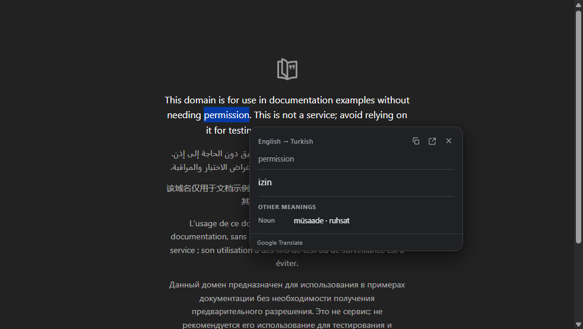

# Translate Selection

A Brave / Chromium extension that translates selected text in a small card next
to the selection, without leaving the page or opening a new tab.



## Features

- Shows a small **Translate** button next to selected text.
- Opens the translation card on the same page.
- Shows the original text, the translation, and the language pair.
- For single-word selections, also lists other meanings grouped by part of
  speech after the primary translation.
- **Copy**, **Open in Google Translate**, **Close**, and **Try again** actions.
- `Ctrl + Shift + Y` shortcut (`Command + Shift + Y` on macOS) and a right-click
  menu item.
- Target language and "open automatically on selection" options.
- English interface, light/dark theme support, and a Shadow DOM UI that survives
  strict page styles and CSP rules.

The default target language is **Turkish**. You can change it from the settings
page; the interface remains English.

## Install (Brave)

### From source

1. Clone the repository:

   ```powershell
   git clone https://github.com/olcanaskar/translate-selection.git
   ```

2. Open `brave://extensions`.
3. Turn on **Developer mode** in the top-right corner.
4. Click **Load unpacked**.
5. Select the cloned `translate-selection` folder.

There is no build step. Refresh tabs that were already open; the content script
is only added to new or reloaded pages.

> Brave may show a developer-mode extension warning from time to time. That is
> normal. The extension also works in Chrome, Edge, and other Chromium-based
> browsers.

## Usage

- **Mouse:** Select some text, then click the **Translate** button next to it.
- **Keyboard:** Select text and press `Ctrl + Shift + Y`
  (`Command + Shift + Y` on macOS).
- **Right-click:** Select text, right-click, then choose **Translate selected
  text**.
- **Settings:** Click the extension icon in the toolbar, or open
  `brave://extensions` → Translate Selection → **Extension options**.

To change the shortcut, use `brave://extensions/shortcuts` (or
`chrome://extensions/shortcuts` in Chrome). Brave already reserves
`Alt + Shift + T` for focusing the toolbar, so the default is `Ctrl + Shift + Y`.

## Settings

- **Target language:** Turkish by default. About 60 languages are supported.
- **Automatic open:** When off, a small button appears next to the selection.
  When on, the translation card opens immediately after selecting text.

## How it works

- `manifest.json`: Manifest V3 definition.
- `background.js`: Sends translation requests to the Google Translate endpoint
  and manages the context menu and keyboard shortcut.
- `languages.js`: Shared language list.
- `content.js`: Selection detection plus the in-page button and card UI
  (isolated from page styles with Shadow DOM).
- `options.html/css/js`: Settings page.
- `icons/`: Extension icons.
- `docs/preview.png`: Screenshot used in this README.
- `test/harness.html`: Local UI test page with a mocked `chrome` API.
- `test/live.html`: End-to-end test page with the real extension loaded.
- `test/live-csp.html`: Verifies the UI on pages with a strict Content Security
  Policy.
- `tools/make-icons.ps1`: Regenerates the icons.

Translation uses this unofficial public endpoint:

```text
https://translate.googleapis.com/translate_a/single?client=gtx&sl=auto&tl=tr&dt=t&q=...
```

This endpoint is not officially documented by Google and may change or be
restricted in the future. The extension only sends the selected text to the
translation service; it does not collect any other data. Do not use it with
sensitive text.

For a single word, the extension also requests `dt=bd`; Google returns
dictionary entries grouped by part of speech, which are displayed under
**Other meanings** after the primary translation.

## Development

Syntax checks:

```powershell
node --check background.js
node --check content.js
node --check languages.js
node --check options.js
```

UI test: open `test/harness.html` and click **Select the text automatically**.
That page uses a mocked `chrome` API and does not require the extension to be
installed.

For a real extension test, start a small local server from the project folder:

```powershell
python -m http.server 8765
```

Then open `http://127.0.0.1:8765/test/live.html`. The `test/live-csp.html` page
checks that the UI still renders on pages with a strict CSP.

## Known limitations

- Does not run on internal pages such as `brave://` or `chrome://` (the browser
  does not allow it).
- Selections longer than 1500 characters do not show the translate button.
- Selections inside iframes are not supported.
- If the Google endpoint is unreachable, the card shows an error message.

## License

MIT
