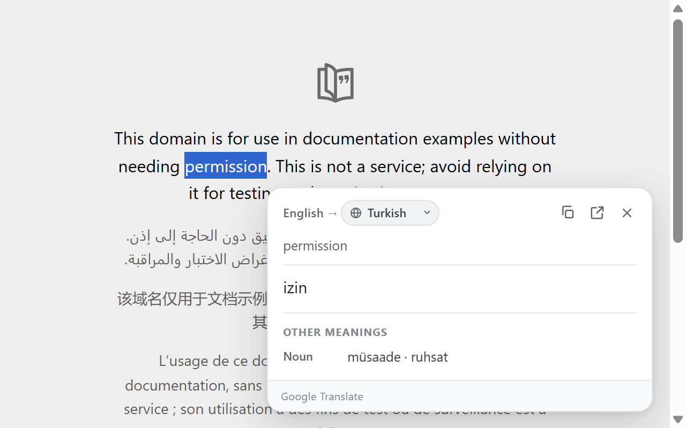

# Translate Selection

**Select text. Translate it without leaving the page.**

[**Download the latest release**](https://github.com/olcanaskar/translate-selection/releases/latest/download/translate-selection.zip) ·
[Privacy Policy](PRIVACY.md) ·
[Report an issue](https://github.com/olcanaskar/translate-selection/issues)

  

Translate Selection is a free, open-source translation extension for Brave,
Chrome, Edge, and other Chromium browsers. Select a word or a sentence and get a
compact translation card right where you are — no new tab, no account, no ads,
no tracking.

## Why you'll like it

- **Translate in place.** A small **Translate** button appears next to your
  selection and opens the result on the same page.
- **Understand words better.** Single-word selections show the main translation
  first and other meanings grouped by part of speech.
- **Switch languages instantly.** Change the target language from the card;
  the current selection is translated again immediately.
- **Nearly 60 languages.** The language list is sorted alphabetically.
- **Dark and light themes.** The interface follows your system theme.
- **Keyboard and right-click support.** Use `Ctrl + Shift + Y`
  (`Command + Shift + Y` on macOS), or right-click and choose **Translate
  selected text**.
- **Privacy-minded.** Selected text is sent to Google Translate only when you
  ask for a translation. There are no analytics, ads, or developer servers.

The interface is English. The default target language is **Turkish**.

## Install

### Brave, Chrome, or Edge (free GitHub release)

> This project is distributed as a free GitHub release. Installation takes
> about a minute and does not require a store account.

1. [**Download the latest release ZIP**](https://github.com/olcanaskar/translate-selection/releases/latest/download/translate-selection.zip).
2. Extract the ZIP to a folder you will keep, for example
   `Documents\TranslateSelection`. Do not delete this folder afterwards.
3. Open your browser's extensions page:
   - Brave: `brave://extensions`
   - Chrome: `chrome://extensions`
   - Edge: `edge://extensions`
4. Turn on **Developer mode**.
5. Click **Load unpacked** and select the extracted folder (the folder that
   contains `manifest.json`).
6. Refresh tabs that were already open. Pin **Translate Selection** to the
   toolbar if you want quick access to settings.

That's it. Select some text on any page and click **Translate**.

> Browsers may show a developer-mode extension notice. This is normal for
> unpacked extensions. If the browser disables the extension after a restart,
> open the extensions page and enable it again.

## How to use it

1. **Select text** on any web page.
2. Click the **Translate** button next to the selection, press
   `Ctrl + Shift + Y`, or right-click and choose **Translate selected text**.
3. Read the translation in the card. You can copy it, open it in Google
   Translate, or close the card.
4. Change the target language from the dropdown in the card. The card
   re-translates immediately and remembers your choice.

Open the extension settings from the toolbar icon. There you can choose the
default target language and enable automatic translation when you select text.

## Privacy

Translation requests are sent to Google Translate only when you explicitly
request a translation. The extension does not run analytics, display ads, or
store selected text on a developer server. Your target-language preference is
stored in browser sync storage.

Read the full [Privacy Policy](PRIVACY.md).

## FAQ

**Is it free?**
Yes. The source code is on GitHub and the installable package is a free GitHub
release.

**Why is it not on the Chrome Web Store?**
The project is distributed directly through GitHub Releases so releases stay
independent and free. You install it once from the release ZIP and update it
from GitHub.

**Does it work in Brave, Chrome, and Edge?**
Yes. It uses Manifest V3 and works in Chromium-based desktop browsers.

**Does it read all the pages I visit?**
The content script adds the in-page Translate button and card, but the extension
only reads the text you select when you ask for a translation. It does not
collect browsing history or page URLs.

**Does it need an internet connection?**
Yes. Translations and alternative meanings come from Google Translate.

**What happens if a translation fails?**
The card shows the error and a **Try again** button.

## Updating

1. Download the latest release ZIP.
2. Extract it over the same folder you used before.
3. Open `brave://extensions` (or the matching page) and click the reload icon on
   Translate Selection.
4. Refresh your tabs.

Keeping the same folder preserves the extension's settings.

## Development

Technical notes, file structure, local testing, and release packaging are in
[DEVELOPMENT.md](DEVELOPMENT.md).

## License

MIT. Not affiliated with or endorsed by Google.
